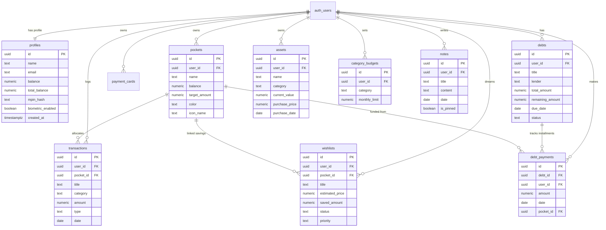

# 💳 MyPocket - Smart Personal Finance Web Application

<p align="center">
  
</p>

<p align="center">
  <b>Aplikasi Manajemen Keuangan Pribadi Next-Generation dengan Desain Mewah, Keamanan mPIN & Biometrik, Multi-Kantong Keuangan, dan Terintegrasi Penuh dengan Database Supabase (PostgreSQL).</b>
</p>

<p align="center">
  
  
  
  
  
</p>

---

## 📑 Daftar Isi
1. [Fitur Unggulan](#-fitur-unggulan)
2. [Arsitektur & Tech Stack](#%EF%B8%8F-arsitektur--tech-stack)
3. [Panduan Integrasi Supabase](#-panduan-integrasi-supabase-lengkap)
   - [Langkah 1: Buat Project Baru di Supabase](#langkah-1-buat-project-baru-di-supabase)
   - [Langkah 2: Ambil API URL & Anon Key](#langkah-2-ambil-api-url--anon-key)
   - [Langkah 3: Konfigurasi File .env.local](#langkah-3-konfigurasi-file-envlocal)
   - [Langkah 4: Eksekusi Skema Database di SQL Editor](#langkah-4-eksekusi-skema-database-di-sql-editor)
   - [Langkah 5: Verifikasi RLS & Auto-Provisioning User](#langkah-5-verifikasi-rls--auto-provisioning-user)
4. [Skema Database (ERD & Tabel)](#%EF%B8%8F-skema-database-erd--tabel)
5. [Cara Menjalankan Secara Lokal (Local Development)](#-cara-menjalankan-secara-lokal-local-development)
6. [Struktur Direktori Project](#-struktur-direktori-project)
7. [Panduan Deployment ke Vercel](#-panduan-deployment-ke-vercel)

---

## ✨ Fitur Unggulan

### 1. 🏠 Home Dashboard
- **Kartu Saldo Dinamis**: Visual kartu violet modern dengan status saldo terkini dan *quick actions* (Transfer & Scan QR).
- **Carousel Kelola Kantong**: Visualisasi persentase pencapaian saldo per kantong tabungan/kebutuhan.
- **Daftar Transaksi Terbaru**: Pengelompokan cerdas (*TODAY*, *YESTERDAY*) dengan ikon kategori dan nominal berwarna.

### 2. 💼 Dompet & Keuangan (Financial Hub)
- 🗂️ **Kelola Kantong (Pockets)**:
  - Pemisahan pos keuangan (misal: Mandiri Utama, Dana Darurat, Tabungan Liburan).
  - Alokasi target dana dan progress bar persentase pencapaian.
  - Fitur **Pindah Dana (Transfer Antar Kantong)** yang otomatis memperbarui saldo kedua kantong secara instan.
- 🧾 **Catatan Hutang & Pinjaman (Debts & Loans)**:
  - Pelacakan pinjaman aktif, tanggal jatuh tempo, dan rincian tenor cicilan.
  - Fitur **Bayar / Cicil Hutang**: Memotong saldo langsung dari salah satu kantong keuangan dan mencatat riwayat cicilan.
- 📈 **Portofolio Aset & Investasi**:
  - Inventarisasi aset properti, kendaraan, logam mulia/emas, saham, obligasi, dan reksadana.
  - Perhitungan otomatis nilai perolehan vs nilai pasar saat ini serta estimasi keuntungan (*gain*).
- 🎯 **Budget Bulanan (Monthly Budgets)**:
  - Batasan belanja per kategori pengeluaran (Shopping, Bill, Food, Entertainment, dll.).
  - Indikator bar pemakaian dengan peringatan jika mendekati batas.
- 💳 **Nomor Rekening & Kartu Bank**:
  - Manajemen multi-rekening bank (BCA, Mandiri, BRI, Bank Jago, dll.).
  - Tombol **1-Klik Salin Nomor Rekening** dengan feedback visual *toast*.
- ✨ **Daftar Barang Impian (Wishlist)**:
  - Pencatatan target pembelian barang idaman dengan target tanggal dan skala prioritas.
  - Tombol **Tandai Sudah Dibeli** & **Batalkan Tercapai** dengan konfirmasi toast.
- 📝 **Catatan Keuangan**:
  - Buku saku untuk mencatat strategi investasi, pengingat pajak, atau memo penting dengan fitur *Pin*.

### 3. 📊 Analisis & Statistik Keuangan
- Grafik garis spline interaktif pengeluaran vs pemasukan.
- Breakdown proporsi pengeluaran berdasarkan kategori transaksi.
- Filter periode waktu fleksibel (Bulanan, Mingguan, Tahunan).

### 4. 🔐 Keamanan & Autentikasi
- **4-Digit mPIN**: Keypad numerik interaktif untuk proteksi akses data privat (Default Demo PIN: `1234`).
- **Simulasi Biometrik**: Sensor sidik jari / Face ID dengan efek radial pulse modern.
- **Auto-Lock Screen**: Perlindungan otomatis saat sesi ditutup atau pengguna keluar dari aplikasi.

### 5. 🌓 Desain Dual-Theme & Borderless
- **Mode Gelap (Dark Mode)**: Nuansa *matte dark fintech* berkelas (`#0A0D15`, `#141824`).
- **Mode Terang (Light Mode)**: Latar kanvas netral `#F1F5F9` dipadukan dengan multi-layer shadow perimeter `0 0 0 1px rgba(15, 23, 42, 0.05)`, mencegah kartu dan tombol putih menyatu dengan background.
- **Borderless Aesthetic**: Desain tanpa garis tepi kasar (*no harsh borders*) dengan sudut membulat modern (`rounded-[20px]`, `rounded-[24px]`).

---

## 🛠️ Arsitektur & Tech Stack

| Komponen | Teknologi | Keterangan |
| :--- | :--- | :--- |
| **Framework** | Next.js 14 (App Router) | Server-side rendering, Client Components, Fast Refresh |
| **Language** | TypeScript (Strict Mode) | Type-safety penuh pada seluruh model data dan state |
| **Styling** | Tailwind CSS 3.4 | Utility-first CSS dengan custom fintech design system |
| **Database & Auth** | Supabase (PostgreSQL) | Managed relational database dengan Row Level Security (RLS) |
| **Client Library** | `@supabase/supabase-js` | SDK resmi Supabase untuk operasi query, auth, dan storage |
| **Animations** | Framer Motion 11 | Transisi halaman mulus, gesture spring, modal dialog |
| **Icons** | Lucide React | Koleksi ikon SVG modern dan konsisten |

---

## 🚀 Panduan Integrasi Supabase Lengkap

Aplikasi MyPocket telah dilengkapi dengan skema database SQL siap pakai dan service client terstruktur di folder [`supabase/schema.sql`](supabase/schema.sql) dan [`src/lib/supabaseService.ts`](src/lib/supabaseService.ts).

Ikuti 5 langkah mudah berikut untuk menghubungkannya:

### Langkah 1: Buat Project Baru di Supabase
1. Buka browser dan login ke [supabase.com](https://supabase.com).
2. Klik tombol **"New Project"**.
3. Pilih **Organization** Anda, masukkan nama project (misal: `mypocket-db`), dan buat password database yang kuat.
4. Pilih region server terdekat (misal: *Singapore* untuk pengguna di Indonesia).
5. Klik **"Create new project"** dan tunggu 1-2 menit hingga proses *provisioning* selesai.

---

### Langkah 2: Ambil API URL & Anon Key
1. Masuk ke dashboard project Anda di Supabase.
2. Pada menu sidebar kiri, klik **Project Settings** (ikon gear ⚙️) > **API**.
3. Salin dua informasi berikut:
   - **Project URL**: Format `https://xxxxxxxxxxxxxxxxxxxx.supabase.co`
   - **Project API Keys (`anon` / `public`)**: Format token JWT panjang diawali `eyJhbGciOi...`

---

### Langkah 3: Konfigurasi File `.env.local`
Di root folder project `MyPocket`, duplikasi file [`.env.example`](.env.example) menjadi `.env.local`:

```bash
cp .env.example .env.local
```

Lalu buka file `.env.local` dan tempelkan kredensial dari Langkah 2:

```env
NEXT_PUBLIC_SUPABASE_URL=https://xxxxxxxxxxxxxxxxxxxx.supabase.co
NEXT_PUBLIC_SUPABASE_ANON_KEY=eyJhbGciOiJIUzI1NiIsInR5cCI6IkpXVCJ9...
```

---

### Langkah 4: Eksekusi Skema Database di SQL Editor
1. Pada menu sidebar Supabase, buka menu **SQL Editor**.
2. Klik tombol **"New query"**.
3. Buka file [`supabase/schema.sql`](supabase/schema.sql) dari repositori ini, salin seluruh kodenya, lalu tempelkan ke SQL Editor Supabase.
4. Klik tombol **"Run"** (atau tekan `Ctrl + Enter`).
5. Supabase akan secara otomatis membuat:
   - 10 Tabel Relasional (`profiles`, `pockets`, `payment_cards`, `transactions`, `debts`, `debt_payments`, `assets`, `category_budgets`, `notes`, `wishlists`).
   - Indeks B-Tree untuk query berkecepatan tinggi.
   - Kebijakan keamanan **Row Level Security (RLS)** pada setiap tabel.
   - Trigger otomatis `handle_new_user()` yang langsung membuat profil dan 3 kantong awal (*Mandiri*, *BRI*, *ShoppePay*) saat pengguna pertama kali mendaftar.
   - Trigger auto-update timestamp `updated_at`.

---

### Langkah 5: Verifikasi RLS & Auto-Provisioning User
1. Masuk ke menu **Table Editor** di Supabase untuk melihat tabel-tabel yang telah dibuat.
2. Pastikan tanda **RLS Enabled** aktif (berwarna hijau) di seluruh tabel.
3. Konfigurasi Auth di menu **Authentication** > **Providers**:
   - Anda dapat mengaktifkan **Email/Password** atau menguji dengan Magic Link.
4. Setiap kali akun pengguna baru terdaftar di Supabase Auth, trigger `on_auth_user_created` akan otomatis mengisikan tabel `profiles` dan menyiapkan kantong keuangan dasar.

---

## 🗄️ Skema Database (ERD & Tabel)

Diagram relasi antar tabel dalam database Supabase MyPocket:



### Rincian Tabel Database
| Nama Tabel | Deskripsi | Proteksi RLS |
| :--- | :--- | :--- |
| `public.profiles` | Menyimpan profil pengguna, total saldo gabungan, status biometrik, dan mPIN. | `auth.uid() = id` |
| `public.pockets` | Pos-pos kantong dana (Mandiri, BRI, ShoppePay, dll.) beserta target pencapaian. | `auth.uid() = user_id` |
| `public.payment_cards` | Nomor rekening bank dan kartu pembayaran dengan status rekening utama. | `auth.uid() = user_id` |
| `public.transactions` | Transaksi pemasukan (*income*) dan pengeluaran (*expense*) terhubung ke kantong. | `auth.uid() = user_id` |
| `public.debts` | Daftar hutang/pinjaman dengan sisa hutang, tenor cicilan, dan status lunas. | `auth.uid() = user_id` |
| `public.debt_payments` | Riwayat pembayaran cicilan hutang yang terhubung ke pemotongan saldo kantong. | `auth.uid() = user_id` |
| `public.assets` | Portofolio aset properti, kendaraan, logam mulia, saham, dan reksadana. | `auth.uid() = user_id` |
| `public.category_budgets` | Batas anggaran belanja bulanan per kategori. | `auth.uid() = user_id` |
| `public.notes` | Catatan keuangan, pengingat, dan strategi keuangan pribadi. | `auth.uid() = user_id` |
| `public.wishlists` | Daftar barang impian (*wishlist*), estimasi harga, dan status pembelian. | `auth.uid() = user_id` |

---

## 💻 Cara Menjalankan Secara Lokal (Local Development)

### 1. Kloning Repositori & Masuk ke Folder Project
```bash
git clone https://github.com/username/MyPocket.git
cd MyPocket
```

### 2. Install Dependensi
```bash
npm install
```

### 3. Setup File Konfigurasi Environment
Salin file `.env.example` ke `.env.local` lalu masukkan kunci Supabase Anda:
```bash
cp .env.example .env.local
```

> **Catatan**: Aplikasi tetap dapat berjalan sempurna dengan fallback simulasi data lokal (*localStorage*) jika variabel lingkungan Supabase belum diisi.

### 4. Jalankan Development Server
```bash
npm run dev
```

Buka browser Anda dan kunjungi:
👉 **[http://localhost:3000](http://localhost:3000)**

---

## 📂 Struktur Direktori Project

```text
MyPocket/
├── .env.example                     # Contoh template variabel lingkungan
├── .env.local                       # Kredensial Supabase lokal (git-ignored)
├── package.json                     # Konfigurasi dependensi project
├── README.md                        # Dokumentasi teknis & panduan lengkap
├── supabase/
│   └── schema.sql                   # Skema SQL PostgreSQL produksi untuk Supabase
├── src/
│   ├── app/
│   │   ├── globals.css              # Sistem styling global, shadow layer & themes
│   │   ├── layout.tsx               # Root layout Next.js dengan ThemeProvider
│   │   └── page.tsx                 # Root view orchestrator & modal wrappers
│   ├── components/
│   │   ├── auth/
│   │   │   ├── LockScreen.tsx       # Layar kunci mPIN & sensor biometrik
│   │   │   └── LoginView.tsx        # Layar autentikasi masuk / daftar
│   │   ├── modals/                  # 15+ Popup & Action Sheets borderless
│   │   │   ├── AddPocketModal.tsx
│   │   │   ├── AddTransactionModal.tsx
│   │   │   ├── AssetManagementModal.tsx
│   │   │   ├── DebtManagementModal.tsx
│   │   │   ├── MovePocketFundsModal.tsx
│   │   │   └── ...
│   │   ├── navigation/
│   │   │   └── BottomNav.tsx        # Navigasi bawah dengan floating (+) action
│   │   └── views/                   # 5 Tampilan Utama Aplikasi
│   │       ├── HomeView.tsx         # Dashboard utama
│   │       ├── AnalyticsView.tsx    # Analisis & statistik grafik
│   │       ├── WalletView.tsx       # Hub Dompet & Keuangan (7 sub-views)
│   │       ├── TransactionsView.tsx # Rincian riwayat transaksi & pencarian
│   │       └── SettingsView.tsx     # Profil & pengaturan preferensi
│   ├── context/
│   │   ├── AuthContext.tsx          # State sesi autentikasi & mPIN
│   │   ├── FinanceContext.tsx       # State reaktif keuangan global
│   │   ├── LanguageContext.tsx      # Sistem bilingual (Bahasa Indonesia & Inggris)
│   │   └── ThemeContext.tsx         # Manajemen tema gelap / terang
│   ├── lib/
│   │   ├── dataService.ts           # Service data reaktif & fallback cache
│   │   ├── dummyData.ts             # Data inisial bawaan demo
│   │   ├── supabaseClient.ts        # Inisialisasi SDK klien Supabase
│   │   └── supabaseService.ts       # Service CRUD terintegrasi Supabase
│   └── types/
│       └── index.ts                 # TypeScript types & interface komprehensif
```

---

## 🌐 Panduan Deployment ke Vercel

MyPocket dirancang khusus agar siap di-deploy secara instan ke platform cloud **Vercel**:

1. Lakukan *Push* kode project ke repositori GitHub / GitLab / Bitbucket Anda:
   ```bash
   git add .
   git commit -m "feat: complete supabase database schema and documentation"
   git push origin main
   ```
2. Buka dashboard [Vercel](https://vercel.com) dan klik **"Add New"** > **"Project"**.
3. Pilih repositori GitHub `MyPocket` Anda dan klik **"Import"**.
4. Pada bagian **Environment Variables**, tambahkan dua variabel kunci:
   - `NEXT_PUBLIC_SUPABASE_URL` = *(URL Project Supabase Anda)*
   - `NEXT_PUBLIC_SUPABASE_ANON_KEY` = *(Anon Public Key Supabase Anda)*
5. Klik **"Deploy"**.
6. Dalam waktu kurang dari 2 menit, aplikasi MyPocket Anda sudah tayang secara langsung di internet dengan performa Edge CDN kelas dunia! 🚀

---

<p align="center">
  Dibuat dengan ❤️ untuk kemudahan pengelolaan finansial masa depan yang rapi, aman, dan estetik.
</p>
